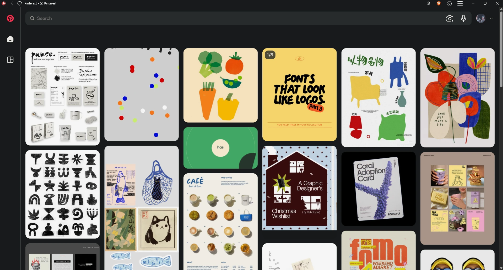
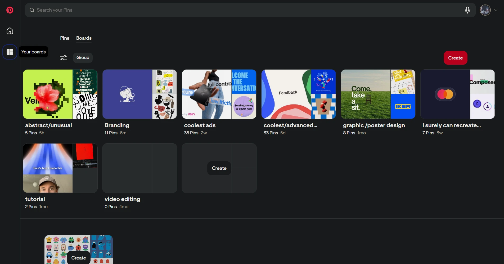

# Pinterest Declutter

A small Manifest V3 extension for Brave and Chrome. It strips Pinterest down to the
**home feed** and **your boards**. Ads, shopping, suggestions and the extra sidebar
icons are hidden. You can flip each item on or off from the toolbar popup, and changes
apply instantly with no page reload.

## Result

**Home feed:** just your pins. The left rail keeps only Home and Boards, and there are no
ads or shopping pins.



**Your boards:** the "Your saved ideas" title and the account block are gone, so the
boards start right under the search bar.



## Install in Brave (load unpacked)

1. Open `brave://extensions` (Chrome: `chrome://extensions`).
2. Turn on **Developer mode** (toggle, top right).
3. Click **Load unpacked**, then pick this folder (the one with `manifest.json`). To get it,
   clone the repo or download it as a ZIP and unzip it.
4. Pin it: click the puzzle-piece icon in the toolbar, then the pin next to **Pinterest Declutter**.
5. Reload any open Pinterest tab.

After editing any file, click the **↻ reload** arrow on the extension's card in
`brave://extensions`, then reload the Pinterest tab.

## What gets hidden

In the popup, a switch that is **on** means that thing is **hidden**. The big switch at
the top turns the whole extension on or off.

| Toggle | Default | What it hides | How it's found |
|---|---|---|---|
| Explore | hidden | Compass icon in the left rail | aria-label starts with `Explore`/`Today`/`Ideas`, or a link to `/ideas/`, `/today/` |
| Create (+) | hidden | Plus icon | aria-label `Create…`, or a link to `/pin-creation-tool/`, `/pin-builder/` |
| Notifications | hidden | Bell icon | aria-label `Notifications`/`Updates`, or a link to `/notifications/` |
| Messages | hidden | Chat bubble icon | aria-label `Messages`/`Inbox`, or a link to `/messages` |
| Settings | hidden | Gear at the bottom of the rail | aria-label `Settings…`, or a link to `/settings` |
| Board tab row | **shown** | The `All · Branding · abstract/unusual …` row above the home feed | `[role="tablist"]` on the home page, with a fallback that looks for an `All` button near the top |
| Promoted pins | hidden | Ad cards in any grid | pin card containing the text `Promoted`, `Promoted by …`, `Sponsored` or `Ad`, or a `data-test-id` containing `promoted` |
| Shopping | hidden | Product pins, Shop tabs, "Shop the look" style sections | pin card with a `Shop…` badge or a price (`$24.99`, `₹1,299`), or a heading or tab whose text starts with `Shop` |
| Page header (Boards group) | hidden | On your saved page: the "Your saved ideas" title and your account block (avatar, name, followers, Share profile), so the boards move up | only on a page with a `Your saved ideas` heading. From that heading, the `Share profile`/`Edit profile` button and the "N followers" text, it hides the biggest wrapper that holds no Pins/Boards tab, toolbar button (Group, Create…), board link or pin. It's collapsed to zero height rather than `display: none`, because Pinterest's boards grid measures the header and breaks if it disappears |
| Board suggestions | hidden | The "Board suggestions" block under your boards | heading text `Board suggestions`, widened only while the block contains nothing before the heading, no links to your boards (`/<user>/<board>/`) and no "N Pins" text, then re-checked whenever new content loads in |
| More ideas / related | hidden | The related-pins grid on `/pin/…` pages, plus the "More ideas" tab on boards | headings like `More to explore`/`More like this`, and every grid card on a pin page *except* the pin you opened: Pinterest can put that pin inside the same grid, so a card is kept if it holds the pin's title or details or is much wider than the others (1.5.1 fix for blank pin pages) |
| Pin titles + ⋯ | **shown** | The title and ⋯ row under each pin card | the ⋯ button's row, but only when it sits below the image (so the hover **Save** button stays) |

Some things are never touched: the **Home** icon, the **Boards/Saved** icon, the search
bar, your avatar menu, the Pins/Boards tabs and toolbar on your saved page, the boards
grid, opening a board, and the pin page itself. Settings is still reachable from the avatar
menu in the top right, even when the gear icon is hidden.

> Hidden ad or product cards leave a gap in the masonry grid. Pinterest positions every
> card absolutely, so the grid can't close the gap without fighting React.

## How it works

Pinterest is a React single-page app with obfuscated class names (`hs0 un8 C9i…`) that
change often, so the extension never uses class names. It works like this:

1. For each toggle that is on, `content.js` puts a class on `<html>`, for example
   `pd-on pd-f-promoted pd-f-navCreate`. It also adds `pd-p-home` on `/` and `pd-p-pin`
   on `/pin/…`.
2. It scans the page and **tags** clutter with `data-pd-hide="<feature>"`. It uses stable
   hooks: `aria-label`, link `href` paths, `data-test-id`, and visible English text. A
   `MutationObserver` checks every new piece of the page in the next animation frame,
   which runs *before* the browser paints, so new clutter is never drawn. A full re-check
   also runs on every page change and every 1.5 s. That catches icons that lay out late
   and pin cards Pinterest reuses for a different pin, and un-hides a reused card that
   is no longer an ad.
3. `content.css` hides `html.pd-f-<feature> [data-pd-hide~="<feature>"]`. Turning a toggle
   off removes the class, so the element comes straight back.

## Tweaking selectors when Pinterest changes

The tunable values sit in the **`CONFIG` block at the top of `content.js`**:

- `gridItem`: selectors for one pin card (`[data-grid-item]`, `div[role="listitem"]`, …).
- `nav`: one entry per rail icon, with `labels` (lowercase aria-label prefixes) and
  `hrefs` (path regexes). If a new icon appears, add its label here.
- `railMaxLeft`: an icon only counts as a rail icon if its left edge is within this many
  pixels of the window edge. This keeps the profile page's own **Create** button safe.
- `boardTabs`: selectors for the board tab row.
- `text`: regexes for visible text (ad badge, Shop badge, price, section headings). They
  are **English only**. If your Pinterest is in another language, add your words here.
- `testIds`: `data-test-id` substrings that hide an element directly.

`content.css` also has a few direct CSS selectors, for example the
`[data-test-id*="pinrep-footer"]` rule for pin titles.

### Finding a new hook

1. On Pinterest, right-click the thing you want gone and choose **Inspect**.
2. Walk up the elements in the panel and look for an `aria-label="…"`,
   `data-test-id="…"`, or an `<a href="/something/">`. Copy that value.
3. Add it to the matching `CONFIG` entry, reload the extension, then reload the tab.

To see what the extension has tagged, run this in the DevTools console on Pinterest:

```js
[...document.querySelectorAll('[data-pd-hide]')].map(e => [e.getAttribute('data-pd-hide'), e])
```

If something you want to keep disappears, its tag shows up in that list. Turn off the
matching toggle, then tighten that rule in `CONFIG`.

## Files

```
manifest.json   MV3 manifest (storage + scripting, Pinterest sites only)
background.js   self-healing: injects the content script into any Pinterest tab where it isn't running
defaults.js     default on/off values + popup labels (shared)
content.js      tagging logic + CONFIG block
content.css     hide rules gated by <html> classes
popup.html/css/js  toggle UI, saved in chrome.storage.sync
icons/          16/32/48/128 px icons
```

## Troubleshooting: "works sometimes"

- **Needed a reload in `brave://extensions` before it worked** (fixed in 1.3.0).
  The browser's own injection (`content_scripts` in the manifest) can miss a page, for
  example tabs Brave restores at start-up before the extension is ready. Reloading the
  extension worked because `background.js` then injected the script by hand. It now does
  that by itself: whenever a Pinterest tab starts loading or is switched to, it pings the
  page, and if no live copy answers it injects one. Pinterest keeps its tabs in the
  "loading" state indefinitely, so the check runs 0.7 s, 2 s and 5 s after each navigation
  starts, without waiting for "complete". On a normal load the ping is answered and
  nothing extra is injected.

- **Page loads looking untouched until you reload the extension** (fixed in 1.2.0).
  Pinterest resets `<html>`'s attributes while it loads, which wiped the `pd-f-*`
  classes the hide rules depend on. The extension that was injected later, on reload,
  ran after that reset, which is why reloading "fixed" it. The script now watches
  `<html>` from the very start and restores its classes, its instance id and its
  `<style>` the moment they disappear, before the browser paints.
- **Open the popup on a Pinterest tab.** The status line says either "✓ Active on this
  tab · N items hidden" or "Not running in this tab. Refresh the Pinterest page."
- **Reloading the extension:** Brave strips an extension's CSS from tabs that were open
  when it was reloaded. `background.js` re-injects a fresh copy into those tabs, and the
  old copy steps aside. The content script also adds its own `<style>`, so hiding keeps
  working even without the manifest CSS. If a tab still looks untouched, refresh it.
- **A tab opened in the background** is cleaned too. Browsers pause animation frames in
  hidden tabs, so a timer runs the cleanup there instead.
- **One thing keeps coming back:** run the console snippet above. If it's not in the list,
  that element doesn't match any rule yet. Inspect it and add its hook to `CONFIG`.

## Caveats

- The selectors were written from screenshots, without a logged-in session to test
  against, so some rules may need a tweak the first time you run it. See above.
- Text matching is English only.
- Regional domains covered: `*.pinterest.com` (including `in.pinterest.com`), `.co.uk`,
  `.ca`, `.com.au`, `.de`, `.fr`, `.es`, `.it`, `.nz`, `.ph`, `.jp`, `.com.mx`. To add
  another, add it to `content_scripts.matches` in `manifest.json`.
